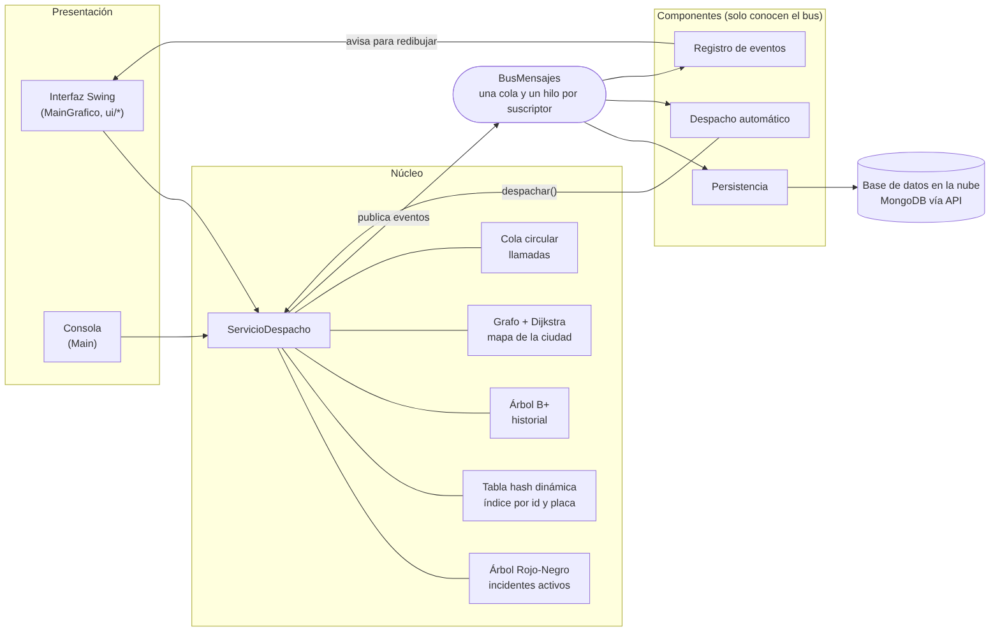
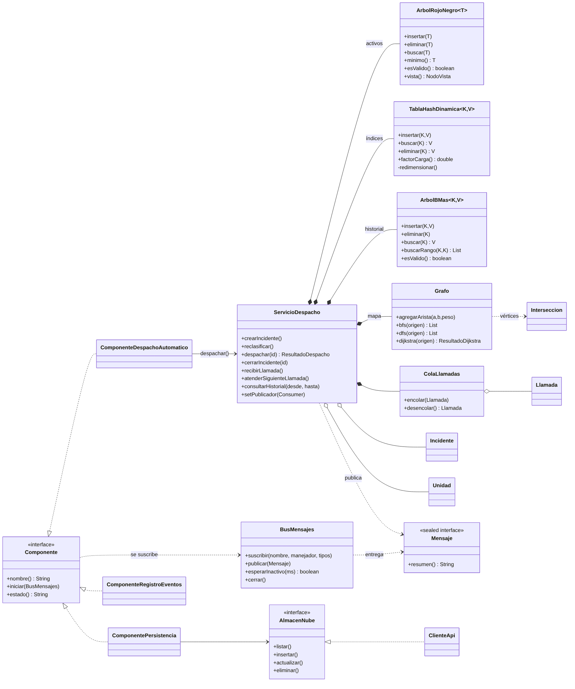
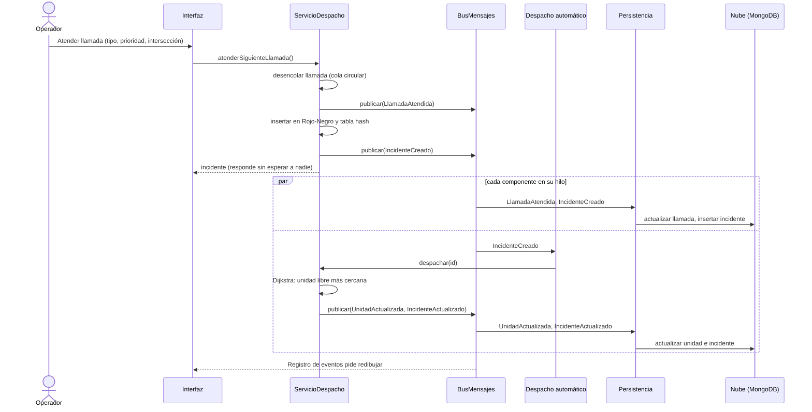
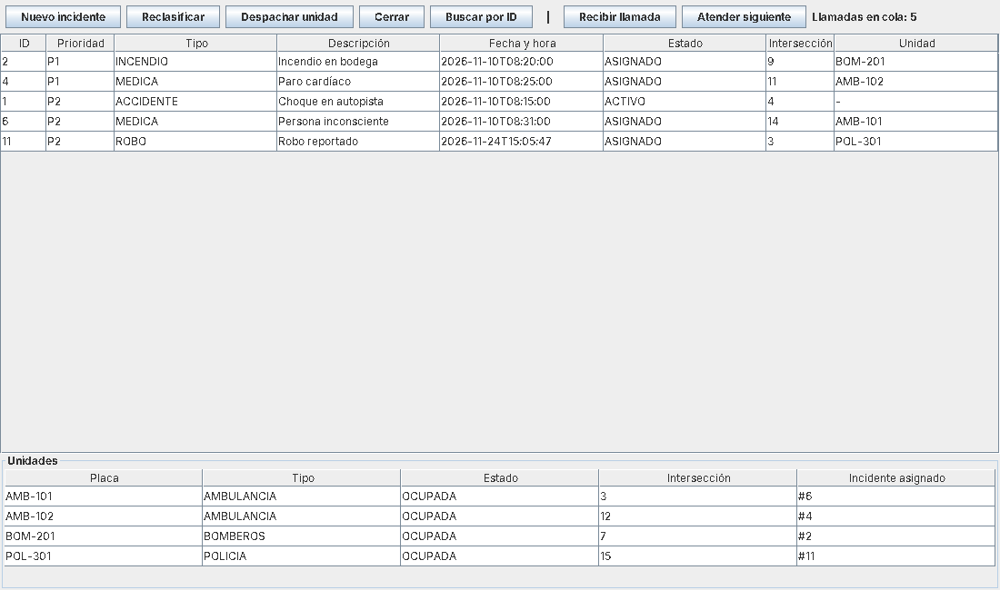
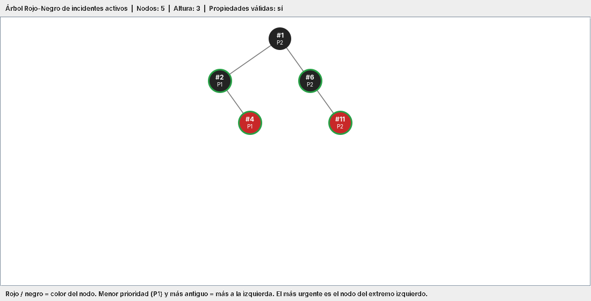
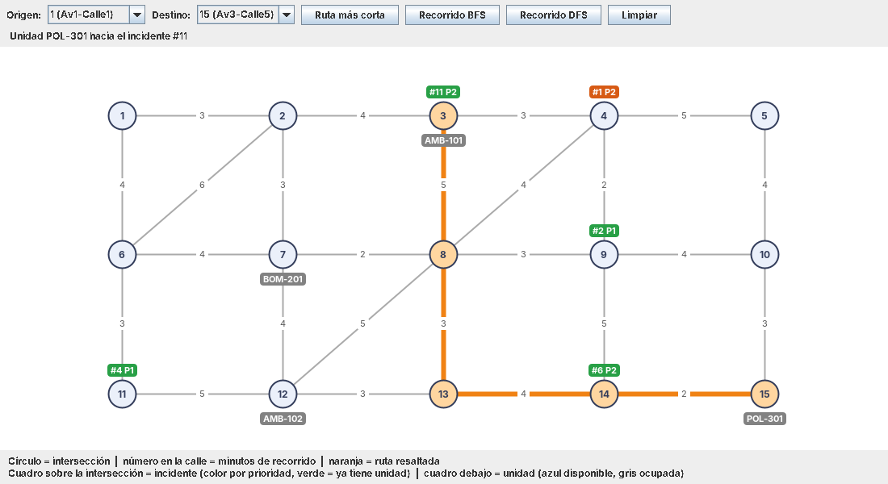
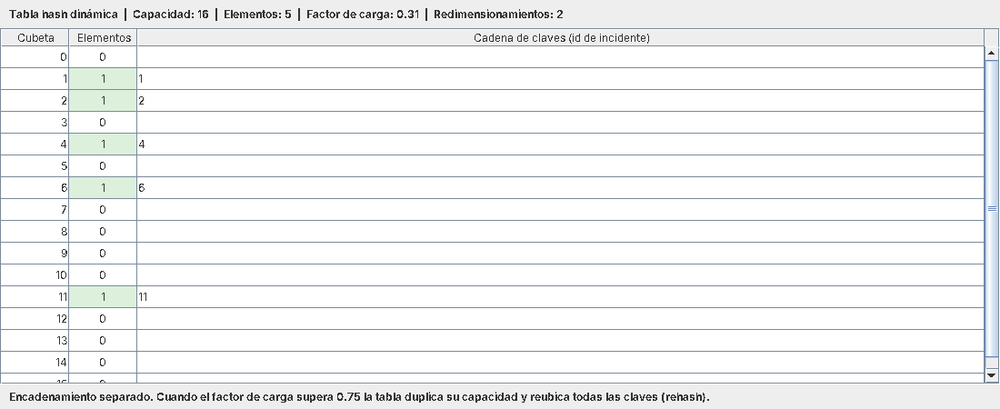
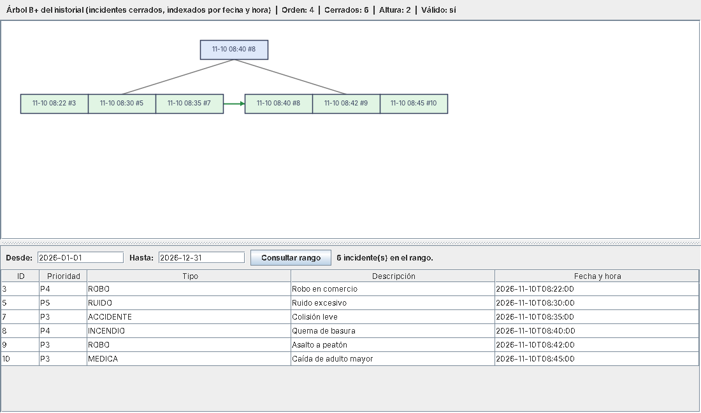
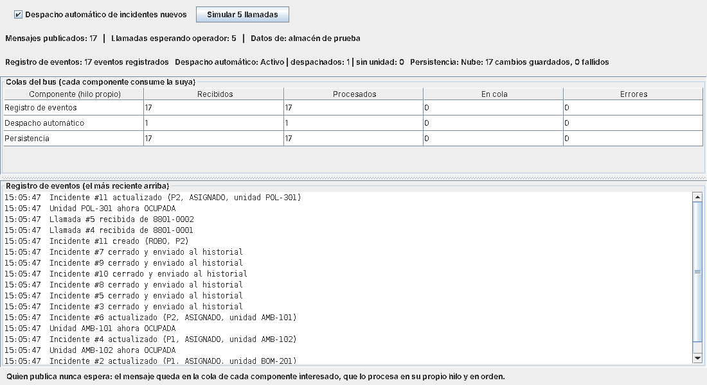

# Informe técnico: Sistema de Despacho de Emergencias

**Curso:** Estructuras de Datos II  **Institución:** CENFOTEC
**Estudiante:** _[completar nombre y carné]_  **Docente:** _[completar]_  **Fecha:** _[completar]_
**Repositorio:** https://github.com/anthonyblanco-dev/DespachoEmergencias

---

## 1. Introducción al problema y descripción de la solución

### 1.1 El problema

Un centro de emergencias recibe llamadas de forma continua. Para cada una debe decidir **qué atender primero**,
**qué unidad enviar** (ambulancia, bomberos o policía) y **por qué ruta**, y no puede perder información si el
sistema se reinicia. Eso exige:

- encontrar siempre el incidente más urgente sin recorrer todos los demás,
- buscar un incidente o una unidad por su identificador casi al instante,
- consultar el historial por rangos de fecha,
- calcular la unidad más cercana sobre un mapa de calles,
- recibir llamadas sin bloquear a quien atiende, y
- guardar todo en una base de datos remota.

### 1.2 La solución

Se desarrolló una plataforma modular en Java con interfaz gráfica (Swing) y de consola. Cada necesidad se resuelve
con la estructura de datos del curso que mejor encaja (sección 3), los módulos se comunican por colas
asincrónicas (sección 4) y los cambios se guardan en la nube (sección 5).

Flujo normal de trabajo:

1. Entra una **llamada** y espera en una cola circular.
2. El operador la **atiende**: se convierte en un **incidente** con tipo, prioridad e intersección del mapa.
3. El incidente entra al árbol Rojo-Negro, que lo ordena por prioridad y hora.
4. Se **despacha** la unidad libre del tipo adecuado que esté más cerca (Dijkstra sobre el grafo de la ciudad),
   a mano o automáticamente.
5. Al **cerrarse**, la unidad se libera y el incidente pasa al historial (árbol B+), donde se consulta por fechas.
6. Cada cambio se anuncia por el bus de mensajes y el componente de persistencia lo guarda en la nube.

---

## 2. Arquitectura del sistema

### 2.1 Paradigma de componentes

El sistema se divide en componentes que **solo se conectan a través del bus de mensajes**. Un componente no conoce
a los demás: recibe mensajes de los tipos que le interesan y, si hace falta, publica otros.

| Componente | Paquete / clase | Responsabilidad |
|---|---|---|
| Núcleo | `servicio/ServicioDespacho` | Reglas del negocio y estructuras de datos; anuncia cada cambio |
| Bus de mensajes | `mensajeria/BusMensajes` | Colas asincrónicas, un hilo por suscriptor |
| Persistencia | `componentes/ComponentePersistencia` | Guarda cada cambio en la nube con reintentos |
| Despacho automático | `componentes/ComponenteDespachoAutomatico` | Asigna unidad a cada incidente nuevo si está activado |
| Registro de eventos | `componentes/ComponenteRegistroEventos` | Guarda los últimos eventos y avisa a la interfaz para redibujar |
| Presentación | `ui/*`, `Main`, `MainGrafico` | Interfaz gráfica y de consola |
| Datos | `datos/*` | Carga desde archivo o nube, interfaz `AlmacenNube` |

Todos los componentes implementan la interfaz `Componente` (`nombre`, `iniciar(bus)`, `estado`).

### 2.2 Diagrama de componentes

### 2.3 Diagrama de clases

### 2.4 Diagrama de secuencia: de la llamada al despacho y la persistencia

Los diagramas están como código Mermaid en [`diagramas/`](diagramas/) (archivos `.mmd`), por si hay que modificarlos.
GitHub también los muestra directamente.

### 2.5 Seguridad entre hilos

La interfaz y los hilos de los componentes usan el mismo `ServicioDespacho`, por eso todos sus métodos públicos son
`synchronized`. Los mensajes del bus llevan **copias** de los objetos del modelo (`copia()`), de modo que un
componente puede procesarlos más tarde aunque el original ya haya cambiado. Los campos `estado` de `Incidente`
y `Unidad` son `volatile` porque la interfaz los lee fuera del bloqueo.

---

## 3. Justificación de las estructuras de datos

| Estructura | Dónde se usa | Por qué esta y no otra | Costo |
|---|---|---|---|
| **Árbol Rojo-Negro** | Incidentes activos, ordenados por prioridad, luego hora, luego id | Un incidente se inserta, se reclasifica (sale y vuelve a entrar con la clave nueva) y se cierra todo el tiempo. Mantiene el orden y garantiza altura ≤ 2·log₂(n+1) sin importar el orden de llegada, así que el más urgente siempre se obtiene en tiempo logarítmico. Una lista ordenada costaría O(n) por cada inserción. | insertar, buscar, eliminar y mínimo: O(log n) |
| **Tabla hash dinámica** | Índice de incidentes por id; unidades por placa | Se busca por id constantemente (reclasificar, despachar, cerrar) y no hace falta orden. Con encadenamiento y rehash al superar el factor de carga 0.75 sigue siendo rápida aunque el número de incidentes crezca. | insertar, buscar, eliminar: O(1) promedio; el rehash es O(n) pero amortizado O(1) |
| **Árbol B+** | Historial de incidentes cerrados, indexado por fecha y hora | El historial solo crece y se consulta por **rangos** ("entre el 10 y el 12 de noviembre"). En un B+ todos los datos están en las hojas y las hojas están enlazadas: se busca el inicio del rango y se recorre hacia la derecha sin volver a subir. Es la misma estructura que usan los índices de las bases de datos, y el nodo grande reduce los accesos a disco. | buscar, insertar, eliminar: O(log_m n); rango: O(log_m n + k) |
| **Grafo ponderado + Dijkstra** | Mapa de la ciudad: 15 intersecciones, 25 calles con tiempo en minutos | Las calles conectan intersecciones y el costo es el tiempo de viaje: es un grafo por naturaleza. Dijkstra desde el incidente da el tiempo hacia **todas** las unidades en una sola pasada y elige la más cercana. BFS y DFS se incluyen para recorridos. | Dijkstra: O((V+E) log V); BFS/DFS: O(V+E) |
| **Cola circular** | Llamadas que esperan al operador | Las llamadas se atienden en orden de llegada. El arreglo circular evita desplazar elementos y duplica su tamaño cuando se llena. | encolar (amortizado) y desencolar: O(1) |

### 3.1 Decisiones de diseño relevantes

- **Clave del Rojo-Negro.** Se compara por prioridad, luego fecha y hora (ISO, se ordena como texto) y por último id.
  Así dos incidentes iguales en prioridad y hora no se confunden y los más antiguos van primero.
- **Reclasificar.** Cambiar la prioridad cambia la clave, por eso el incidente se elimina y se vuelve a insertar
  en lugar de modificarse en su lugar.
- **Clave del B+.** `ClaveHistorial(fechaHora, id)`: dos incidentes registrados en el mismo segundo no chocan.
- **Verificadores.** El Rojo-Negro y el B+ tienen `esValido()`: comprueban raíz negra, ausencia de rojo-rojo y
  altura negra; o bien límites de claves por nodo, orden, separadores, misma profundidad y cadena de hojas.
  Las pruebas lo llaman repetidamente durante inserciones y borrados.
- **Borrado en el B+.** Está implementado completo (préstamo al hermano o fusión, y la raíz baja de nivel).
- **Mapa fijo.** El grafo siempre sale del archivo local: es configuración, no datos que cambien durante la operación.

---

## 4. Servicio de colas: comunicación asincrónica entre componentes

`BusMensajes` es un bus de **publicación/suscripción** hecho con colas bloqueantes (`LinkedBlockingQueue`):

- Cada suscriptor tiene **su propia cola y su propio hilo**.
- `publicar` deja el mensaje en la cola de cada suscriptor interesado y **vuelve de inmediato**: quien publica nunca espera.
- Cada suscriptor procesa en **orden de llegada**.
- Si un manejador lanza una excepción, se cuenta como error y el hilo sigue con el siguiente mensaje.
- `esperarInactivo` espera a que se vacíen todas las colas, incluidos los mensajes que los propios manejadores publiquen.
- `cerrar` procesa lo pendiente y detiene los hilos.

Mensajes (`Mensaje`, interfaz sellada con registros inmutables): `LlamadaRecibida`, `LlamadaAtendida`,
`IncidenteCreado`, `IncidenteActualizado`, `IncidenteCerrado`, `UnidadActualizada` y `DespachoFallido`.

**Por qué un bus propio y no un broker externo.** El enunciado pide integrar un servicio de colas para comunicación
asincrónica entre componentes. Un bus en proceso cumple eso sin infraestructura adicional y permite probarlo sin red.
`Componente` y `Mensaje` están diseñados para que, si se exigiera un broker real (RabbitMQ, por ejemplo), solo haya que
cambiar la implementación del bus. _(Confirmar con el docente que esta decisión es aceptable.)_

---

## 5. Base de datos en la nube

Se usa MongoDB a través de una API HTTP (`ClienteApi`), detrás de la interfaz `AlmacenNube`
(`listar`, `insertar`, `actualizar`, `eliminar`). Colecciones: `despacho_unidades`, `despacho_incidentes`
y `despacho_llamadas`.

**Lectura.** Al arrancar se leen las tres colecciones. Si la nube está vacía se siembra con los datos iniciales del
archivo; si no responde, el sistema funciona con el archivo local y los cambios quedan solo en memoria.

**Escritura.** El componente de persistencia guarda cada cambio en segundo plano, así la interfaz nunca espera a la red:

| Mensaje | Operación en la nube |
|---|---|
| `LlamadaRecibida` | insertar en `despacho_llamadas` |
| `LlamadaAtendida` | actualizar la llamada (`atendida = true`, queda como registro) |
| `IncidenteCreado` | insertar en `despacho_incidentes` |
| `IncidenteActualizado`, `IncidenteCerrado` | actualizar por `{"id": n}` |
| `UnidadActualizada` | actualizar por `{"placa": "..."}` |

- Siempre se envía el **documento completo**, para que el resultado sea el mismo si la API mezcla campos o reemplaza el documento.
- Cada escritura se **reintenta 3 veces**; si las tres fallan se cuenta como fallida y el componente sigue con el siguiente cambio.
- Al **cerrar el programa** se espera a que se vacíen las colas (hasta 10 s) para no perder guardados pendientes.

**Reconstrucción al volver a cargar.** Los incidentes con estado `CERRADO` regresan al árbol B+; las llamadas ya
atendidas no vuelven a la cola; cada incidente guarda `placaAsignada`, así que cerrarlo después de un reinicio
sigue liberando su unidad. Además, `reconciliar()` corrige datos que no cuadren (una unidad `OCUPADA` sin incidente
vuelve a `DISPONIBLE`; un incidente `ASIGNADO` a una unidad inexistente vuelve a `ACTIVO`).

---

## 6. Integración continua

El flujo `.github/workflows/ci.yml` se ejecuta en cada push y pull request a `main`:

1. Instala Java 25 (Temurin) con caché de Maven.
2. `mvn package`: compila y genera el jar ejecutable con sus dependencias.
3. Ejecuta las siete pruebas de `pruebas/`.
4. Publica el jar como artefacto (el "despliegue" controlado: cada versión que pasa las pruebas queda descargable).

Si cualquier prueba lanza una excepción, el paso falla y el flujo se marca en rojo.

---

## 7. Interfaz de usuario

Interfaz gráfica en Swing con una pestaña por estructura, más la gestión diaria y las colas. También hay una consola
con el mismo conjunto de operaciones (opciones 1 a 19). Las capturas siguientes se generaron con datos de ejemplo.

| Pestaña | Muestra |
|---|---|
| Incidentes y unidades | Tabla de incidentes por urgencia, unidades y su estado; crear, reclasificar, despachar, cerrar, llamadas |
| Árbol Rojo-Negro | Nodos rojos y negros con id y prioridad; borde verde = ya tiene unidad |
| Mapa (grafo) | Intersecciones, calles con minutos, incidentes y unidades; ruta resaltada; BFS, DFS y ruta más corta |
| Tabla hash | Cubetas, cadenas de colisión, factor de carga y redimensionamientos |
| Historial (árbol B+) | Árbol con hojas enlazadas y consulta por rango de fechas |
| Mensajería (colas) | Estado de cada cola, despacho automático, simulador de llamadas y registro de eventos |

---

## 8. Pruebas y análisis de resultados

Todas son programas ejecutables en `src/main/java/com/cenfotec/despacho/pruebas/` y no requieren red.
Cada una lanza una excepción si algo falla y termina con `PRUEBA SUPERADA` si todo cumple.

| Prueba | Qué verifica | Resultado observado |
|---|---|---|
| `PruebaArbolRojoNegro` | 2000 inserciones aleatorias y borrado de la mitad, validando las propiedades cada 100 operaciones | 1977 claves distintas, altura 14 (el límite teórico es 21); tras borrar 989 quedan 988, altura 14; siempre válido |
| `PruebaArbolBMas` | Órdenes 3, 4, 5, 6 y 8 contra un `TreeMap`: inserción, búsqueda, 200 rangos aleatorios, recorrido completo y borrado total en orden aleatorio | Coincide con la referencia en todos; alturas máximas 9, 7, 6, 5 y 5 con unas 1300 claves (a mayor orden, menos niveles); queda vacío y válido |
| `PruebaTablaHash` | 5000 inserciones, búsquedas y borrados contra un `HashMap` | Crece de 4 a 4096 cubetas en 10 redimensionamientos; el factor de carga nunca superó 0.75; resultados idénticos a la referencia |
| `PruebaGrafo` | Dijkstra, BFS y DFS en un grafo de resultado conocido, con un vértice aislado | Ruta 1→4 por 1-3-2-4 en 4 min; el vértice aislado no es alcanzable |
| `PruebaDespacho` | Flujo completo con los datos reales: despacho a la unidad más cercana, sin unidades disponibles, cierre, historial, rangos de fecha, ids | La ruta 7-8-9 de 5 min coincide con el cálculo a mano sobre el mapa; cerrar libera la unidad |
| `PruebaBus` | Orden de entrega, filtrado por tipo, error en un manejador, publicar sin esperar, mensajes encadenados, cuatro publicadores a la vez, cierre | 25 mensajes publicados en ~0 ms mientras el consumidor tarda ~1 s; llegan los 2000 mensajes de 4 hilos; un manejador que falla no detiene su hilo |
| `PruebaPersistencia` | Sembrar, trabajar, **reiniciar y volver a cargar** desde un almacén en memoria; datos inconsistentes; reintentos; fallo definitivo; despacho automático | El estado tras el reinicio coincide; 2 fallos seguidos se recuperan con reintentos; tras un fallo definitivo el componente sigue guardando; con 2 ambulancias libres y 3 incidentes se asignan 2 y el tercero genera `DespachoFallido` |

**Análisis.**

- Las alturas observadas están muy por debajo de la cota teórica del Rojo-Negro y bajan al subir el orden del B+, como predice la teoría.
- Las pruebas del bus y la persistencia se repitieron 15 veces cada una (30 ejecuciones) sin ningún fallo, para descartar condiciones de carrera.
- La persistencia se probó contra un almacén falso en memoria (`AlmacenMemoria`) que puede simular fallos de red. La interfaz `AlmacenNube` es lo que lo hace posible.

---

## 9. Limitaciones y trabajo futuro

- **Entrega de los cambios.** Si las 3 escrituras de un cambio fallan, ese cambio no se reenvía después. Una cola persistente de pendientes lo resolvería.
- **Un solo operador.** Los identificadores se generan en el programa; con varios operadores a la vez haría falta que la base de datos los asigne.
- **Bus en proceso.** Los componentes comparten el mismo programa. Para repartirlos en servidores distintos habría que cambiar el bus por un broker (RabbitMQ, Kafka).
- **Mapa fijo.** Los tiempos de las calles no reflejan tráfico real.
- **Pruebas.** Son programas propios, no JUnit; migrarlas permitiría informes de cobertura.

## 10. Conclusiones

Cada estructura del curso tiene un papel concreto: el Rojo-Negro mantiene el orden de urgencia, la tabla hash da
acceso inmediato por id, el B+ responde consultas por rango, el grafo decide la ruta y la cola ordena las llamadas.
El diseño por componentes con un bus asincrónico permitió agregar persistencia en la nube y despacho automático sin
modificar las reglas del núcleo, y las pruebas con un almacén falso permitieron comprobar la persistencia sin depender de la red.
